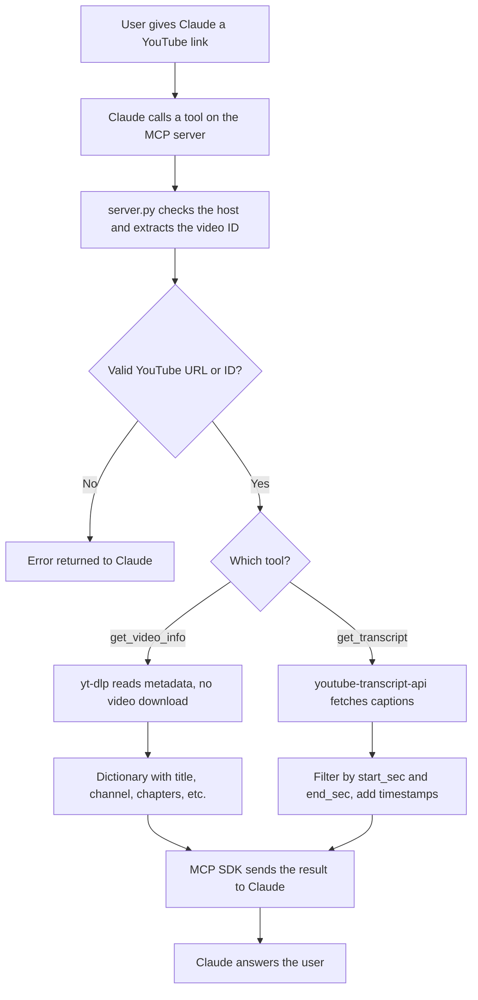
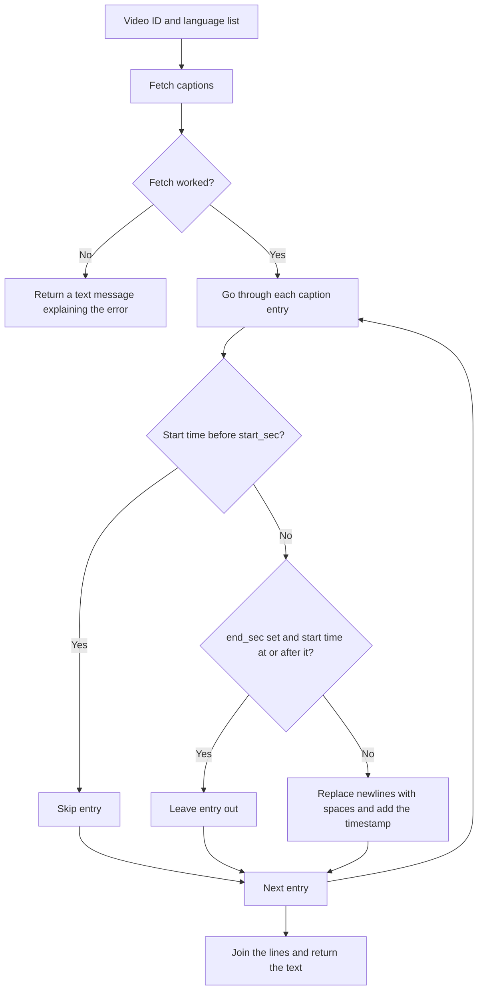

# YouTube Research MCP Server

A small Python server that gives an MCP-compatible assistant (Claude Code or Claude Desktop) two tools for working with YouTube videos. You give it a video URL, and it returns the video's details or its captions with timestamps.

It only works with text. It does not download videos, look at frames, run OCR, or search transcripts by meaning.

## Tools

**`get_video_info(url)`**

Returns the video ID, canonical URL, title, channel, duration, upload date, view count, description, tags, and chapters when the video has them. Fields that YouTube does not provide come back as `None`, and missing chapters come back as an empty list.

**`get_transcript(url, start_sec=0, end_sec=None, languages=None)`**

Returns the captions as timestamped lines.

- `start_sec` and `end_sec` pick a section of the video. They are compared against each caption's start time, so a caption that starts before `end_sec` is kept in full and is not cut at the exact end point.
- `languages` is a list of language codes tried in order. The default is English (`en`).
- Hours are shown in the timestamps only for videos that are an hour or longer.

## How it works

Claude starts `server.py` as a local process and talks to it over stdio. The client reads the tool list from the server, and the assistant calls a tool when it needs video data.



### What happens inside `get_transcript`



## Supported links

- Standard links: `youtube.com/watch?v=ID`
- Short links: `youtu.be/ID`
- Other paths: `/shorts/ID`, `/embed/ID`, `/live/ID`, `/v/ID`
- `youtube-nocookie.com` links
- A bare video ID of exactly 11 characters (letters, digits, `_` and `-`)

Links without `https://` are treated as HTTPS. Any other host is rejected. A valid-looking ID does not prove the video exists. That is only known after the fetch.

## Project files

| File | Purpose |
| --- | --- |
| `server.py` | MCP server, URL checks, both tools, timestamp formatting |
| `requirements.txt` | Dependencies (`mcp` 1.x, `yt-dlp`, `youtube-transcript-api`) |
| `.gitignore` | Keeps `.venv`, caches, secrets and editor files out of Git |
| `mcpinfo.txt` | Project brief, design notes and technical Q&A |

The MCP SDK is limited to `>=1.2.0,<2.0` because `server.py` imports `FastMCP` from `mcp.server.fastmcp`, and that API changed in version 2.

## Requirements

- Python 3.10 or newer (the code uses type hints like `int | None`)
- Internet access to YouTube

## Install on Windows

From the project folder:

```powershell
py -3 -m venv .venv
.\.venv\Scripts\python.exe -m pip install --upgrade -r requirements.txt
```

If the `py` launcher is missing, install Python 3.10 or newer first, or use the full path to your Python to create the venv.

## Connect to Claude Code

Replace `YOUR_NAME` and the folder with your own path:

```powershell
claude mcp add --scope user --transport stdio youtube -- "C:\Users\YOUR_NAME\Downloads\youtube-mcp\.venv\Scripts\python.exe" "C:\Users\YOUR_NAME\Downloads\youtube-mcp\server.py"
```

Then check it with `claude mcp get youtube` or `claude mcp list`. Inside a Claude Code session, `/mcp` shows the server status.

## Connect to Claude Desktop

In Claude Desktop, go to Settings, then Developer, then Edit Config. Add this inside the existing `mcpServers` object and keep any other entries that are already there:

```json
"youtube": {
  "command": "C:\\Users\\YOUR_NAME\\Downloads\\youtube-mcp\\.venv\\Scripts\\python.exe",
  "args": [
    "C:\\Users\\YOUR_NAME\\Downloads\\youtube-mcp\\server.py"
  ]
}
```

Save the file and restart Claude Desktop.

Claude Code and Claude Desktop are set up separately. In both, use the full path to the venv's Python. A different Python will probably be missing the dependencies.

  ## example prompt :
  Use my YouTube MCP tools to analyze this video: https://youtu.be/I4B37S1dyQQ   // any yt link

1. Retrieve the video title and available metadata.
2. Retrieve the transcript, if available.
3. Summarize the main concepts.
4. Explain the technical topics with examples.
5. Generate 10 interview questions based on the video.

Use the connected tools to retrieve information rather than guessing. If a requested capability is unavailable, tell me.